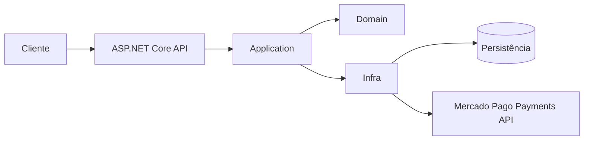

# Serviço de Orçamento

Microsserviço da plataforma Tech Challenge responsável pelas operações de orçamento e pelo processamento de pagamentos.

## Visão geral

A API oferece operações relacionadas a orçamentos e integração com o Mercado Pago para processar o pagamento de um orçamento aprovado.

## Arquitetura

O serviço segue uma arquitetura em camadas: a API recebe as requisições HTTP, a camada Application coordena os casos de uso, Domain concentra as regras de negócio e Infra implementa persistência e integrações externas. O projeto IOC registra as dependências.



| Projeto | Responsabilidade |
|---|---|
| `src/OrcamentoService` | API HTTP, controllers, middleware e configuração da aplicação |
| `src/Application` | Casos de uso e orquestração |
| `src/Domain` | Entidades, agregados, objetos de valor e regras de negócio |
| `src/Infra` | Persistência e integração com o Mercado Pago |
| `src/IOC` | Registro e composição das dependências |
| `src/Tests` | Testes automatizados de Application, Domain e Infra |

## Tecnologias

- .NET e ASP.NET Core
- Mercado Pago Payments API
- Docker e Docker Compose
- GitHub Actions e SonarQube

## Executar localmente

Pré-requisitos: SDK do .NET e Docker com Docker Compose.

```bash
dotnet restore src/OrcamentoServiceSolution.slnx
dotnet run --project src/OrcamentoService/OrcamentoService.csproj
```

Para executar com Docker Compose:

```bash
docker compose -f src/docker-compose.yml up --build
```

## API e documentação

- Swagger UI: `http://localhost:5184/swagger`
- OpenAPI JSON: `http://localhost:5184/openapi/v1.json`
- Verificações de saúde: `/health/live`
- Controller: `src/OrcamentoService/Controllers`
- Exemplo de pagamento: [OrcamentoService.http](./src/OrcamentoService/OrcamentoService.http)

## Integração com a Saga de abertura da OS

O Orcamento Service é um participante do fluxo coordenado pelo OS/Estoque Service; ele não implementa nem persiste o estado da Saga. A comunicação entre os serviços é feita por chamadas HTTP síncronas, sem publicação ou consumo de eventos por mensageria.

1. Durante a abertura da OS, o orquestrador calcula o valor e chama `POST /api/Orcamento/CriarOrcamento`.
2. Se uma etapa posterior da abertura falhar, o orquestrador chama `POST /api/Orcamento/NegarOrcamento` como compensação para o orçamento que conseguiu identificar.
3. A decisão do cliente é registrada separadamente por `POST /api/Orcamento/AprovarOrcamento` ou `POST /api/Orcamento/NegarOrcamento`.
4. Antes de atribuir um mecânico para execução, o OS/Estoque Service consulta `GET /api/Orcamento/OrcamentoAprovado?ordemservicoid={id}`. A resposta indica aprovação somente quando o orçamento está aprovado e ainda não foi pago.

A criação e a decisão do orçamento são operações próprias deste serviço; o orçamento não inicia automaticamente a execução da OS nem envia um evento de aprovação. A aprovação, a consulta de status e a atribuição do mecânico são etapas independentes do fluxo de compensação executado na abertura.

## Pagamento de orçamento (DEV)

A API cria o pagamento diretamente pela Payments API (`POST /v1/payments`) do Mercado Pago; ela não cria uma Order. O orçamento precisa estar aprovado e o valor é obtido do orçamento persistido, não do cliente.

Configure o Access Token de teste da aplicação no ambiente antes de executar a API. Não armazene a credencial em arquivos versionados:

```powershell
$env:MercadoPago__AccessToken = "TEST-seu-access-token"
```

O endpoint `POST /api/Orcamento/PagamentoEfetuado` recebe o orçamento, o token do cartão gerado no cliente com o SDK oficial do Mercado Pago, o método de pagamento, parcelas, e-mail do pagador e uma chave UUID de idempotência. O número do cartão e o CVV não devem ser enviados à API; eles devem ser tokenizados no cliente e o token não é armazenado.

A resposta contém o ID e o status do pagamento retornados pelo Mercado Pago. O orçamento só é marcado como pago quando o status é `approved`; pagamentos recusados não impedem uma nova tentativa. Reutilize a mesma chave UUID ao repetir a mesma chamada após timeout; após uma recusa, gere uma chave nova para iniciar outra tentativa.

O estado `processing` é salvo no DynamoDB antes da chamada ao provedor; quando o Mercado Pago responde, seus identificadores e status substituem esse estado e são persistidos junto com o orçamento.

Referência oficial: [Payments API](https://www.mercadopago.com.br/developers/pt/reference/payments/_payments/post).

## Testes e cobertura

O cenário BDD de falha na criação do orçamento e execução das compensações está no repositório OS/Estoque Service; os testes específicos deste serviço cobrem regras de orçamento, handlers e integração com o provedor de pagamentos.

Para executar a suíte de testes:

```bash
dotnet test src/OrcamentoServiceSolution.slnx --configuration Release
```

O pipeline exige cobertura mínima de 80% de linhas para os testes de Domain e Application. Os testes de Infra também são executados, mas não têm limiar de cobertura configurado no pipeline.

### Evidência de cobertura

Adicione o print da execução dos testes abaixo. Salve a imagem em `docs/images/cobertura-testes.png` ou ajuste o caminho para o arquivo que você adicionar ao repositório.


## Docker e Kubernetes

- Dockerfile: [src/Dockerfile](./src/Dockerfile)
- Docker Compose: [src/docker-compose.yml](./src/docker-compose.yml)
- Manifestos Kubernetes: não há manifestos versionados neste repositório. O workflow de deploy reinicia o Deployment `orcamento-deployment` no cluster configurado.

## CI/CD

- [CI de branches feature](./.github/workflows/ci-cd-local.yml): build, testes, análise SonarQube e criação de PR para `main`.
- [Deploy da branch main](./.github/workflows/deploy-main-dockerhub.yml): build e publicação da imagem `maquese/orcamento` no Docker Hub e atualização do Deployment no Kubernetes.

Configure os secrets e variáveis necessários no GitHub Actions, incluindo credenciais do SonarQube e do Docker Hub.
